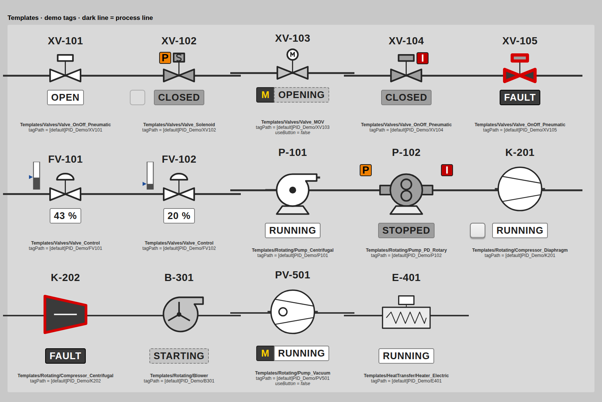

# EFC Ignition Library

Every EFC Ignition Perspective design (**Ignition 8.1**, ready for 8.3) in one repo: the projects, the generators that build them, tags, symbols and design docs. [`docs/inventory.md`](docs/inventory.md) lists every design and its status.

Everything ships as **one Perspective project, `EFC_Library`** (no parent). Its views live under a single `Templates/` tree:

| Folder | What's in it | Source |
|---|---|---|
| `Templates/Valves`, `Rotating`, `HeatTransfer`, `_Demo` | 16 controlled-device templates (P&ID symbols embedded as Drawings) | `generator/build_pid.py` |
| `Templates/ProcessValues` | `PV_StatusStrip`, `PV_RangeBar` with ISA-18.2 alarm letters | `generator/build_pv.py` |
| `Templates/Loops` | PID loop cards B1–B4 and `Popups/LoopConfig` | `generator/pid_loops/` |
| `Templates/Station` | DDT_Station sidebar, fill and tile faceplates | `imported/EFC_StationFaceplates/` |
| `Templates/IO` | Modicon x80 I/O card faceplates, parts and `RackOverview` | `imported/EFC_IOFaceplates/` |
| `Styles/_Catalog` + style classes + stylesheet | EFC_Styles: 166 ISA-101 classes, light-gray scheme, vh-scaled | `generator/build_styles.py` |

Also in the repo: 214 plain P&ID SVGs in `symbols/`, nav-connector options A–D, tags (UDTs and demo instances) in `tags/`, HTML mockups in `mockups/`, and one rendered image per view in `docs/previews/templates/`. Retired material is in `archive/` (see `archive/ARCHIVED.md`).

Current version: see [`VERSION.json`](VERSION.json). What changed: see [`CHANGELOG.md`](CHANGELOG.md).



## Repository layout

```
build.py                 one command to regenerate, merge, check and package everything
VERSION.json             library version + release date
generator/               SOURCE OF TRUTH for the generated parts
  build_styles.py          EFC_Styles classes + palette
  build_pid.py             PID_Symbols templates (one per symbol)
  build_pv.py, common.py   process-value templates + PV demo tags
  pid_loops/               PID loop cards, popup, UDT + demo tags
  nav_connectors/          off-page connector SVG options + mockup
  render_views.py          renders every view to docs/previews/templates/ (review images)
  pid_common.py, active.py, v2/, check_81.py, preview*.py, make_project_zip.py
imported/                SOURCE for parts built in the Designer (EFC_IOFaceplates, EFC_StationFaceplates)
projects/EFC_Library/    GENERATED: the single merged project, gateway folder layout. Don't hand-edit.
tags/                    UDTs + demo instances (Tag Browser import JSON)
symbols/                 GENERATED: 214 plain SVGs
mockups/                 HTML design previews
docs/                    inventory, reference docs, template-review.md, previews/
archive/                 retired files, kept for reference (not built)
tools/import_project_zip.py  add or refresh a Designer-built part in imported/
```

`build.py` builds the generated parts in `build/components/`, merges them with `imported/` into `projects/EFC_Library`, and fails if any embedded view, repeater or popup path doesn't resolve. `build/` and `dist/` are ignored by git.

## Working on the library

Requires Python 3.9 or later, with no packages needed. Previews also need `pip install playwright` and a Chromium.

```bash
# 1. edit generator/*.py
python3 build.py --preview      # 2. regenerate projects/, tags/, symbols/, docs/ and render the preview
git diff --stat                 # 3. review: every template/style change is a JSON diff under projects/
git commit -am "..."            # 4. commit generator AND generated files together
```

- **Don't hand-edit `projects/`.** The next build overwrites it. Change the generator, or re-import the Designer export into `imported/`.
- **Preview first:** look at `docs/previews/templates.png` and `docs/previews/templates/` before committing a visual change. This is the agreed workflow rule.
- **Releases:**
  1. Bump `VERSION.json` and add a `CHANGELOG.md` entry.
  2. Run `python3 build.py --dist`.
  3. Tag the commit (`git tag v7.1`) and attach the `dist/*.zip` files to the release.
- **CI** (`.github/workflows/check.yml`): rebuilds on every push and fails if the committed `projects/` doesn't match the generator and `imported/`, or if the 8.1 import check fails.

## Getting it onto a gateway

**Option A: import the zip.** Run `python3 build.py --dist`, then in the Gateway web page go to Config → Projects → Import and import `dist/EFC_Library_PROJECT.zip`. Use it on its own, or make it the parent of your HMI project.

**Upgrading from v6.x:** EFC_Library replaces EFC_Styles, PID_Symbols, EFC_PID_Library, EFC_ProcessValues, PID_Loops, EFC_IOFaceplates and EFC_StationFaceplates. Re-point any HMI project that inherits from one of them to EFC_Library, then delete the old projects. Two folders moved: `IO/…` is now `Templates/IO/…` and `PID/…` is now `Templates/Loops/…`; update any of your own screens that embed or open those views by path.

**Option B: copy the folder.** `projects/EFC_Library/` uses the gateway's `data/projects/<Name>/` layout. Copy it into `<ignition>/data/projects/`, then run `system.project.requestScan()` from the Script Console or restart the gateway.

**Tags:** in the Tag Browser, import `tags/*_UDT.json` into Data Types. Import `tags/PV_Demo_Tags.json` at the `[default]` provider root to try `Templates/ProcessValues/_Demo`, `tags/PID_Demo_Instances.json` for `Templates/_Demo`, and the Station and PID_Loops demo files for theirs. Real discrete valves use the plant `DDT_Valve` UDT. See [`docs/library-reference.md`](docs/library-reference.md).

## Adding or refreshing a Designer-built part
```bash
python3 tools/import_project_zip.py EFC_IOFaceplates.zip
python3 build.py --preview && git add -A && git commit -m "Refresh I/O faceplates"
```
Parts in `imported/` have no generator here, so edit them in the Designer, export, and re-import. A new part also needs its name added to `IMPORTED_PARTS` in `build.py`.

## Documentation
- [`docs/inventory.md`](docs/inventory.md): every design, version, status and location.
- [`docs/template-review.md`](docs/template-review.md): findings from the rendered review images.
- [`docs/library-reference.md`](docs/library-reference.md): templates, UDT mapping, status logic, colors, 8.1 compatibility.
- [`docs/design-notes.md`](docs/design-notes.md): every design decision (notes 1–42) and the open items.
- [`docs/isa101-audit.md`](docs/isa101-audit.md): the ISA-101 / ISA-18.2 audit and documented deviations.
- [`docs/style-library.md`](docs/style-library.md) / [`docs/style-class-index.md`](docs/style-class-index.md): how to use EFC_Styles; every class (generated).
- [`docs/pv-display.md`](docs/pv-display.md) / [`docs/pv-style-index.md`](docs/pv-style-index.md): process-value templates.
- [`docs/pid-loop-templates.md`](docs/pid-loop-templates.md): PID loop cards and popup.
- [`docs/screen-layout-standard.md`](docs/screen-layout-standard.md): 16:9 screen layout and graphics conventions.
- [`docs/station-faceplates.md`](docs/station-faceplates.md): station faceplates, member mapping, dock setup.
- [`docs/design-briefs.md`](docs/design-briefs.md): I/O card and station faceplates, compressor screen, Haskel pump.
